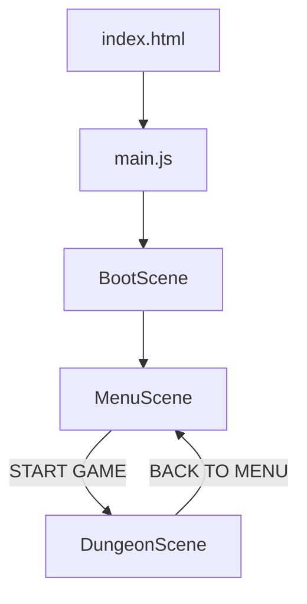
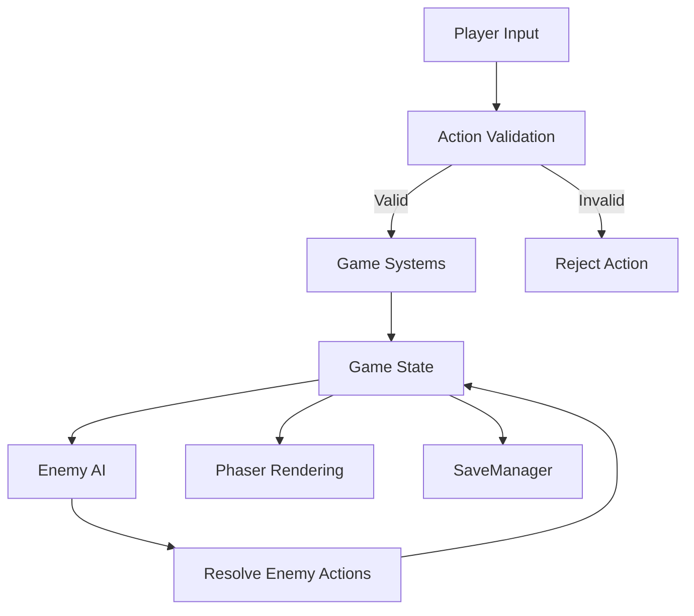

# Dungeon Quest 系統架構

## 1. 架構原則

本專案採用模組化 JavaScript 架構，
將場景呈現、遊戲規則、資料及系統職責分離。

核心遊戲規則應盡量保持獨立於 Phaser 渲染層，
以利後續使用 Node.js 進行自動化測試。

## 2. 技術分層

| 層級 | 職責 |
| --- | --- |
| Presentation | Phaser 場景、畫面及動畫 |
| Input | 鍵盤與滑鼠輸入 |
| Game Systems | 移動、回合、戰鬥、AI |
| Domain Entities | 玩家、敵人與道具狀態 |
| Data | 地圖、敵人及道具配置 |
| Persistence | 本機存檔與讀檔 |

目前已實作 Presentation 層的基本場景管理，
其餘核心系統將依里程碑逐步建立。

## 3. 目前場景架構

## 4. 已實作模組

| 檔案 | 職責 |
| --- | --- |
| index.html | HTML 入口及遊戲容器 |
| src/main.js | Phaser Game 初始化 |
| src/style.css | 全域樣式與畫面配置 |
| src/scenes/BootScene.js | 遊戲啟動 |
| src/scenes/MenuScene.js | 主選單及互動 |
| src/scenes/DungeonScene.js | 地下城場景與關卡資料呈現 |
| src/data/levels.js | 不可變地圖及關卡配置 |
| tests/levels.test.js | 地圖資料單元測試 |
| src/systems/GridMap.js | 地圖座標、地形、通行、相鄰格及畫面座標轉換 |
| tests/grid-map.test.js | GridMap 單元測試 |
| src/entities/Player.js | 玩家資料、座標與生命值管理 |
| tests/player.test.js | Player 單元測試 |

## 5. 預計新增模組

| 模組 | 職責 |
| --- | --- |
| Player | 玩家狀態與行為 |
| Enemy | 敵人狀態與行為 |
| Boss | 特殊敵人與階段行為 |
| GridMap | 地圖座標及合法性檢查 |
| MovementSystem | 格子移動與碰撞 |
| Pathfinding | A* 路徑搜尋 |
| EnemyAI | FSM 與行為決策 |
| TurnManager | 玩家與敵人的回合順序 |
| CombatSystem | 傷害、攻擊及死亡判定 |
| Inventory | 背包與裝備管理 |
| SaveManager | 存檔、讀檔及資料驗證 |
| HUD | 遊戲狀態顯示 |
| GameOverScene | 失敗畫面 |
| VictoryScene | 勝利畫面 |

上述模組尚未實作，名稱及位置可依開發需要調整。

## 6. 預定資料流

此圖為目標架構，不代表目前已實作。

## 7. 資料管理

- 地圖以二維陣列表示地形。
- 角色位置使用整數格子座標。
- 遊戲資料與視覺物件分離。
- 敵人及道具數值集中管理。
- 存檔資料使用可序列化 JSON 結構。
- 遊戲規則不得完全依賴畫面座標。

## 8. 遊戲引擎設定

- Phaser：4.2.1
- Vite：目前安裝 8.3.8
- 邏輯解析度：960 x 640
- 縮放模式：Scale.FIT
- 置中模式：CENTER_BOTH
- 像素渲染：啟用

## 9. 測試策略

- 核心演算法：單元測試。
- 系統協作：整合測試。
- 場景及介面：瀏覽器操作測試。
- 正式版本：Vite Build 與 Preview。

## 10. 技術限制

目前不包含後端伺服器或資料庫。

localStorage 僅提供本機瀏覽器存檔，
不保證跨裝置同步或防止使用者修改資料。

正式發布前應檢查遊戲資源容量、載入效能、
第三方資源授權及瀏覽器相容性。

## M1-B GridMap 實作補充

GridMap 不依賴 Phaser，接受關卡資料及畫面偏移量，驗證矩形地圖、地形、尺寸與偏移，並保存不可變地圖副本。

| 方法 | 行為 |
| --- | --- |
| isInBounds(x, y) | 檢查整數格子座標與邊界 |
| getTile(x, y) | 查詢地形，非法座標回傳 null |
| isWalkable(x, y) | 僅地板可通行 |
| isWall(x, y) | 判斷是否為牆壁 |
| getNeighbors(x, y) | 依上、右、下、左順序取得可通行相鄰格；非法或不可通行起點回傳空陣列 |
| toWorldPosition(x, y) | 轉換為格子中心的畫面座標；非法座標回傳 null |

DungeonScene 透過 GridMap 查詢地形並繪製地圖，驗證玩家起點並取得玩家畫面座標。
玩家狀態、移動與碰撞、鍵盤輸入及 A* 尋路仍屬後續開發範圍。

## M1-C Player 實作補充

Player 為不依賴 Phaser 的角色資料類別，以 private fields 與 getter 封裝狀態。

| 方法 | 行為 |
| --- | --- |
| constructor(options) | 初始化非負安全整數座標及屬性；maxHp、level 至少為 1，初始 HP 等於 maxHp |
| getPosition() | 回傳獨立座標物件 |
| setPosition(x, y) | 驗證座標格式後更新，回傳新座標 |
| isAlive() | HP 大於 0 為存活 |
| takeDamage(amount) | 扣除已計算傷害，最低為 0，回傳實際扣除量 |
| heal(amount) | 不超過 maxHp，死亡時不復活，回傳實際恢復量 |

DungeonScene 先以 GridMap 驗證關卡起點，再建立 Player，將格子座標轉為畫面座標並讀取 getter 顯示初始 HUD。每次進入場景建立新 Player。
座標邊界與牆壁碰撞由後續 MovementSystem 負責；鍵盤輸入、動態 HUD、戰鬥公式、升級及存檔尚未實作。
